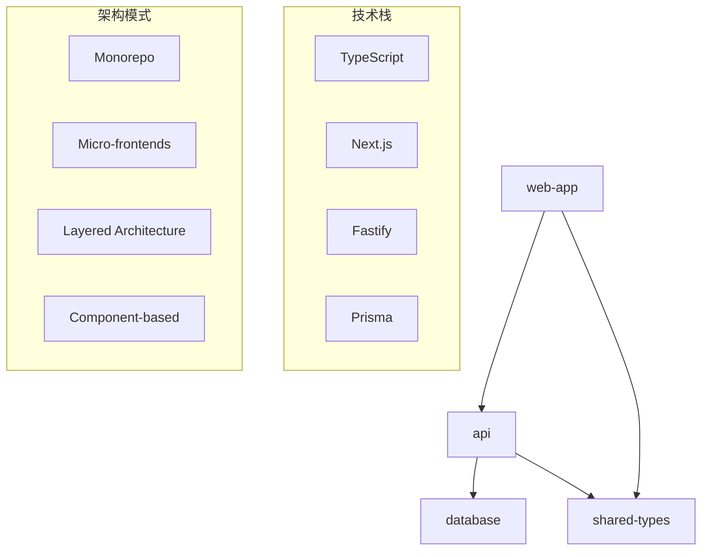

# 项目架构分析报告

## 基本信息
- **项目路径**: D:\1Work\project\cost_demo_2
- **分析时间**: 2026/8/28 09:51:31
- **项目类型**: fullstack-monorepo

## 架构概览
- **主要架构模式**: Monorepo, Micro-frontends, Layered Architecture, Component-based
- **核心框架**: @fastify/cors, @fastify/jwt, @fastify/swagger, @fastify/swagger-ui, fastify...
- **技术栈**: tailwind-merge, @prisma/client

## 🎨 架构图

### Mermaid 图表


### ASCII 架构图
```
┌─────────────────────────────────────────────────┐
│              项目架构概览                      │
├─────────────────────────────────────────────────┤
│                                                 │
│  ┌─────────────┐                              │
│  │  web-app          │                              │
│  └─────────────┘                              │
│              │                                 │
│              └─────────────────────────────────┤
│                                              │
│              ┌─────────────┐                 │
│              │  api              │                 │
│              └─────────────┘                 │
│                                              │
│              └─────────────────────────────────┤
│                                              │
│              ┌─────────────┐                 │
│              │  shared-types     │                 │
│              └─────────────┘                 │
│                                              │
│  ┌─────────────┐                              │
│  │  api              │                              │
│  └─────────────┘                              │
│              │                                 │
│              └─────────────────────────────────┤
│                                              │
│              ┌─────────────┐                 │
│              │  database         │                 │
│              └─────────────┘                 │
│                                              │
│              └─────────────────────────────────┤
│                                              │
│              ┌─────────────┐                 │
│              │  shared-types     │                 │
│              └─────────────┘                 │
│                                              │
│  ┌─────────────┐                              │
│  │  shared-types     │                              │
│  └─────────────┘                              │
│              │                                 │
│  ┌─────────────┐                              │
│  │  database         │                              │
│  └─────────────┘                              │
│              │                                 │
├─────────────────────────────────────────────────┤
│              技术栈:                           │
│  tailwind-merge, @prisma/client  │
└─────────────────────────────────────────────────┘

```

## 目录结构
```
: .codexignore, .env, .gitignore
.example: .env.example
.local: .env.local
.md: AGENTS.md, CLAUDE.md, README.md
.log: dev.log
.yml: docker-compose.yml
.json: package.json, turbo.json
.yaml: pnpm-lock.yaml, pnpm-workspace.yaml
.agents/
  skills/
    api-design-principles/
    auth-implementation-patterns/
    brainstorming/
    build-check/
    code-review/
    component-development/
    database-migration/
    error-handling-patterns/
    executing-plans/
    finishing-a-development-branch/
    git-commit/
    nodejs-backend-patterns/
    postgresql-table-design/
    react-best-practices/
    requesting-code-review/
    shadcn-ui/
    sql-optimization-patterns/
    subagent-driven-development/
    systematic-debugging/
    tailwind-design-system/
    test-driven-development/
    type-safety/
    verification-before-completion/
    version-release/
    webapp-testing/
    writing-plans/
    writing-skills/
.claude/
  .json: settings.local.json
  hooks/
    .js: experience-promoter.js, insight-capture.js
    .sh: pre-commit-check.sh
    .md: README.md
    .py: skill-activation.py
  plans/
    .md: system-config-implementation.md
  skills/
    api-design-principles/
    auth-implementation-patterns/
    brainstorming/
    build-check/
    code-review/
    component-development/
    database-migration/
    error-handling-patterns/
    executing-plans/
    finishing-a-development-branch/
    git-commit/
    nodejs-backend-patterns/
    postgresql-table-design/
    react-best-practices/
    requesting-code-review/
    shadcn-ui/
    sql-optimization-patterns/
    subagent-driven-development/
    system-demo-video/
    systematic-debugging/
    tailwind-design-system/
    test-driven-development/
    type-safety/
    verification-before-completion/
    version-release/
    webapp-testing/
    writing-plans/
    writing-skills/
  worktrees/
    agent-a4246eb78ed145bdb/
    agent-a529a5c940bb722e8/
    agent-a60b71e0f8d8d6060/
    agent-a66f1931f64dfc208/
    agent-aea611c753775d236/
    agent-afaf32140fd69737e/
    task3-packaging-material/
.memory/
  .md: memory.md
.turbo/
  cache/
    .tmp: .dfb269af9983c1cb.tar.zst.37528.0.tmp
    .json: 03cfc58dc36654c5-meta.json, 06065ff7b8c769d4-meta.json, 07332ec8b1d7af91-meta.json...
    .zst: 03cfc58dc36654c5.tar.zst, 06065ff7b8c769d4.tar.zst, 07332ec8b1d7af91.tar.zst...
.worktrees/
  fix-quote-save/
    : .env, .git, .gitignore
    .example: .env.example
    .local: .env.local
    .md: CLAUDE.md, README.md
    .yml: docker-compose.yml
    .json: package.json, turbo.json
    .yaml: pnpm-lock.yaml, pnpm-workspace.yaml
    .claude/
    .memory/
    apps/
    docs/
    packages/
    scripts/
    tasks/
apps/
  api/
    : .env
    .example: .env.example
    .mjs: eslint.config.mjs
    .json: package.json, tsconfig.json
    .ts: vitest.config.ts
    .turbo/
    src/
  web/
    .local: .env.local
    .json: components.json, package.json, tsconfig.json
    .mjs: eslint.config.mjs, next.config.mjs, postcss.config.mjs
    .ts: middleware.ts, next-env.d.ts, vitest.config.ts...
    .tsbuildinfo: tsconfig.tsbuildinfo
    .next/
    .turbo/
    app/
    components/
    hooks/
    lib/
    providers/
    public/
    stores/
    styles/
docs/
  .md: HANDOFF.md
  plans/
    .md: 2026-03-08-layered-architecture-refactoring.md, 2026-03-08-refactor-user-customer-modules.md, 2026-03-13-api-migration-plan.md...
  summary/
    .md: api-endpoints.md, auth-permission.md, calculation-rules.md...
packages/
  database/
    : .env
    .json: package.json, tsconfig.json
    .turbo/
    prisma/
    src/
  shared-types/
    .json: package.json, tsconfig.json
    .turbo/
    src/
scripts/
  .sql: adapt-schema-complete.sql, adapt-schema.sql, old_schema.sql
  .ts: analyze-quotations.ts, fix-quotations-customer.ts, fix-quotations-migration.ts...
  .js: explore-old-db.js
  .md: field_mapping.md, FINAL_VALIDATION_REPORT.md, MIGRATION_REPORT.md
  .json: migration_report.json, table_stats.json
  .sh: setup.sh
  demo-video/
    .ts: generate-demo.ts, pages.config.ts
    .md: README.md
tasks/
  .md: lessons.md, todo.md

```

## 依赖关系
```
web-app → api, shared-types
api → database, shared-types
shared-types → 
database → 

```
## 架构分析
### 优势
- 采用 Monorepo 架构，便于统一管理
- 使用 Turborepo 进行构建优化
- 前后端分离，职责清晰
- 组件化设计，便于复用和维护

### 建议
- 考虑引入 API 网关统一管理接口
- 加强类型定义的一致性
- 考虑引入缓存层提升性能
- 添加监控和日志系统

### 技术优化建议
